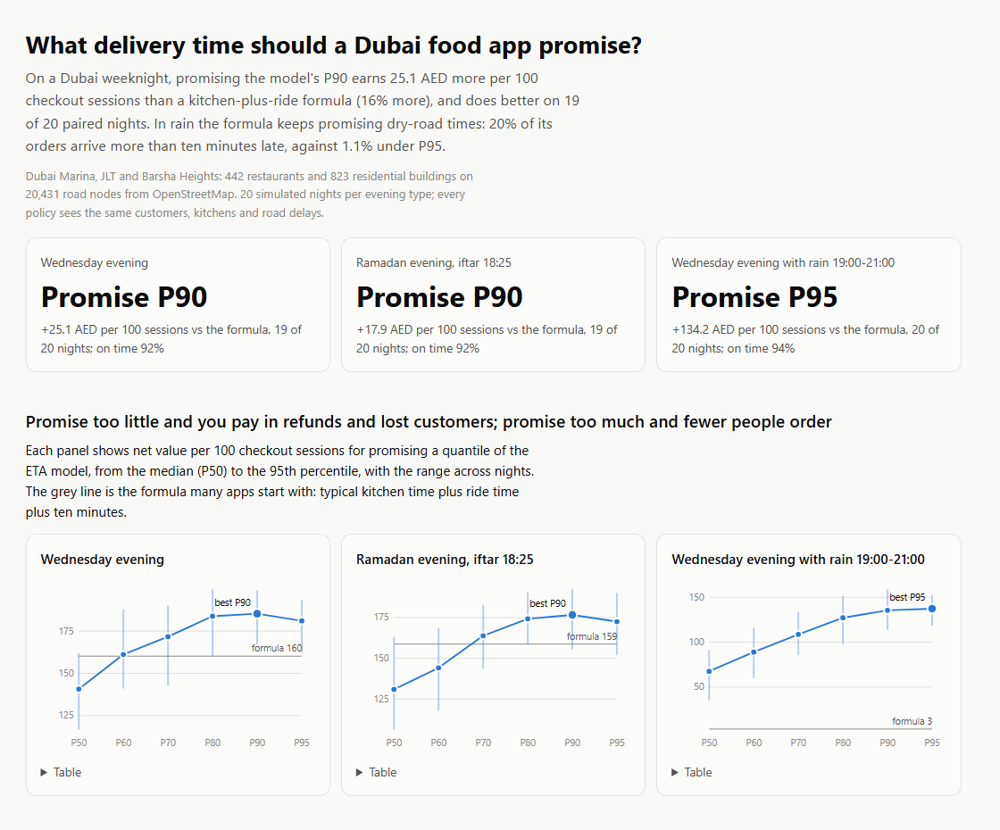
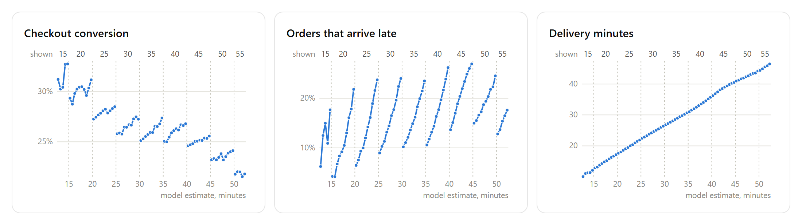

A simulation of Dubai food delivery on real roads that answers one product question, finds that the answer turns on two numbers nobody publishes, and then finds a way to read both from data every delivery app already has.

## TL;DR

I simulated delivery evenings in Dubai Marina, JLT and Barsha Heights on their actual OpenStreetMap roads (442 restaurants, 823 residential buildings, 20,431 road nodes) to decide what delivery time an app should promise at checkout.

- **Promise a high quantile of an ETA model, not a formula and not the median.** On a weeknight, promising the model's 90th percentile earns 16% more per checkout session than "kitchen time plus ride time plus ten minutes", and is on time 92% of the time instead of 79%.
- **Rain is where the formula breaks.** It keeps promising dry-road times; a fifth of its orders arrive more than ten minutes late. A model that knows it is raining promises about six minutes more and keeps the promise.
- **The exact quantile turns on two numbers nobody publishes**: how much conversion each promised minute costs, and how much a late minute costs in customers who don't come back. Across plausible values the winner runs from P70 to P95.
- **Both numbers are hiding in the logs.** Apps round the promise up to five minutes, so two checkouts estimated at 29.9 and 30.1 minutes are the same order shown "30 min" and "35 min". That rounding is a natural experiment. In 4,000 simulated evenings built to fool a dashboard, the dashboard says a promised minute costs **0.9%** of conversion; the rounding steps say **2.1% (1.9–2.3%)**; the truth is **2%**.
- **The same steps separate a broken promise from slow food**, which a cut of repeat rate by lateness cannot do, and they **catch a dispatcher that quietly spends the promise**.
- **A negative result worth keeping:** promises barely feed back on themselves here, so retraining the ETA model on its own outcomes is safe.

The rounding trick is borrowed from economics, where it is a standard design. Using the ETA's own rounding to measure both numbers that set the promise is, as far as I could find, new. It is validated in simulation where the truth is known, not yet on a real platform's logs.

---

## Where this came from

An old folder of mine was called "Last Mile Algorithms": routing experiments, nearest-driver assignment, the usual. Rebuilding it, I kept coming back to the fact that the most-seen number in a delivery product isn't a route. It's the promise on the checkout screen: "35–40 min". It is set by a policy, not by the customer. Set it low and the app looks fast, converts better, and then pays for every order that misses it: refunds, "where is my order" contacts, and customers who quietly stop ordering. Set it high and the promise is kept, but some customers see 45 minutes and close the app.

Dubai makes the question sharper than most cities. Two in five residential buildings in the area I modeled are towers, where the last hundred metres mean a lobby, a security desk and a lift. Addresses are often landmarks ("near the Spinneys entrance"). Rain is rare and catastrophic for the roads. And for a month a year, every order in the hour before iftar is for a fixed moment.

## The setup

**The city.** Roads, restaurants and residential buildings from OpenStreetMap, 356 of them towers of ten floors or more, with one-way rules kept and motorbike speeds by road class. Real routes take a median 1.8 times the straight-line time and 3.7 times at the 90th percentile: crossing Sheikh Zayed Road means an interchange.

**An evening.** Checkout sessions arrive by hour, and each converts less the longer its promise. Kitchens take a restaurant-specific time that grows with their queue. The rider who can reach the restaurant soonest takes the order. Rides follow shortest paths, stretched by traffic and rain; the level and tail width of those delays come from a public delivery dataset, used for its shape only. The last hundred metres cost two minutes plus five seconds a floor in a tower, more for a landmark address and for cash on delivery.

**The ETA model.** Quantile gradient-boosted trees trained on simulated history, predicting delivery minutes from what the platform knows at checkout. Each policy promises one quantile, rounded up to five minutes the way apps display it.

**The economics.** Commission and fee against rider time; refunds from a published tier schedule when a late customer gets in touch; the cost of handling contacts; and future orders lost per late minute. Every policy sees the same customers, kitchens and road delays (common random numbers), so differences between policies come from the policy alone.

## Result 1: promise a high quantile, not a formula

Twenty simulated nights per evening type:

| Evening | Formula promise | Best promise | Net per 100 checkout sessions | On time | More than 10 min late |
|---|---|---|---|---|---|
| Wednesday | kitchen + ride + 10 min | P90 | 160 → 185 AED (+16%, better on 19 of 20 nights) | 79% → 92% | 4.8% → 0.9% |
| Ramadan, iftar 18:25 | same | P90 | 159 → 177 AED (+11%, 19 of 20) | 81% → 92% | 3.8% → 1.0% |
| Rain 19:00–21:00 | same | P95 | 3 → 137 AED (20 of 20) | 58% → 94% | 20.1% → 1.1% |

Promising the median is the worst option: it converts best and earns about a quarter less than P80–P90. The promises are honest: promising the 90th percentile gets 92% of orders there in time.

## Result 2: rain and iftar

In rain the formula keeps promising dry-road times while roads jam and demand rises. Refunds reach 470 AED a night and the evening barely breaks even. The model knows it is raining, promises about six minutes more, and keeps it.

In the hour before iftar the roads jam as everyone drives home, and orders are for a fixed moment. Under the formula 5.1% of iftar orders arrive after iftar; under P90, 1.2%; under P95, 0.4%.

## Result 3: the promise drives the support load, and an AI agent can answer it safely

Late orders become contacts. In rain, the formula generates 69 contacts a night and P95 generates 14. Those contacts go to a support agent running under the deterministic kernel I wrote about in [Model proposes, kernel admits](/posts/2026/09/harness-ultra/): the order record is trusted, the customer's message is not, and the published refund policy becomes bounded authority for each contact.

An agent that does whatever customers ask requests 18,320 AED on a typical rainy night; the kernel lets 1,082 through, all within policy. An agent that follows the policy pays 497. Across 120 simulated nights no refund exceeded policy.

(Batching two orders per rider, for completeness, barely pays in an area this dense: it saves about 1% of rider time per order and costs slightly on net, even with a quarter of the fleet missing.)

## The part that decides everything: two numbers nobody publishes

P80, P90 and P95 are within noise of each other on paired nights. Which one wins depends on how much conversion each extra promised minute costs, and how much a late order costs in future orders. Neither is in any public dataset. Across the plausible range the winner on dry evenings runs from P70 (conversion very sensitive, lateness cheap) to P95 (the reverse).

The textbook ways to measure them are both flawed. A test that shifts the promise works, but on a delivery platform its two arms share the same riders, so one arm's orders slow the other's down. And the obvious cuts of existing data mislead. Busy hours bring longer promises *and* keener customers, so conversion by promise length understates the cost of a minute. Late orders are also slow orders, so repeat rate by lateness blames the broken promise for the slowness too.

## The experiment already in the logs

Apps round the ETA up to five minutes. Two checkouts whose model estimates are 29.9 and 30.1 minutes are alike in everything that matters, but one is shown "30 min" and the other "35 min". Comparing checkouts just either side of each multiple of five is a **regression discontinuity**: the jump in conversion at the step is the causal effect of five promised minutes. The only thing to add to the logs is the estimate before rounding.

To test it where the truth is known, I logged 4,000 simulated weeknights (6.4 million checkouts, 1.6 million orders) of a platform promising P80, in a world deliberately built to fool a dashboard: busy hours bring both longer promises and keener customers. The true cost of a promised minute is fixed in advance at 2%.

Each segment is one promise shown. Conversion drops at every step, where the promise jumps by five minutes, and drifts *up* inside each band, because longer estimates come in busier hours when customers are keener. That drift is exactly what fools a dashboard. The share of late orders drops at the steps too, since a longer promise is broken less often. Delivery minutes don't jump at all, because nothing downstream reads the promise.

| World | Truth | Dashboard | Rounding steps (95% interval) |
|---|---:|---:|---:|
| Busy hours bring keener customers | 2% | 0.9% | 2.1% (1.9–2.3%) |
| Nothing confounds | 2% | 2.0% | 2.3% (1.9–2.6%) |
| Keener busy hours, truth 1% | 1% | 0.0% | 0.8% (0.4–1.1%) |
| Keener busy hours, truth 3% | 3% | 2.0% | 3.1% (2.7–3.4%) |

With a true elasticity of 1%, the dashboard concludes the promise doesn't matter at all. The steps recover it. On precision: 100 evenings of one area's checkouts give an interval about ±1.3 points wide; 1,000 evenings pin it to ±0.4. Split into ten separate blocks of evenings, the 95% interval covers the truth in 9 of 10, and it matches a bootstrap that resamples whole nights.

**The cost of a broken promise, separately from slow food.** Across a step the promise moves by five minutes and the delivery does not. So the jump in repeat orders at the step, divided by the jump in late minutes, is the cost of the broken promise alone. I tested it on two kinds of simulated customer: ones who punish broken promises on top of slowness (set to lose 0.5 points of retention per late minute, the asymmetry Gui and Drerup report from Instacart data), and ones who only mind speed.

| Customers | Truth, per late minute | Repeat-rate cut | Rounding steps (95% interval) |
|---|---:|---:|---:|
| Punish broken promises | −0.50 pts | −1.56 pts | −0.41 pts (−0.60 to −0.21) |
| Only mind speed | 0 | −1.57 pts | +0.09 pts (−0.11 to +0.28) |

The repeat-rate cut says the same thing for both kinds of customer, and triples the true cost for the first. The steps tell them apart. This reading is data-hungry, though: only orders near a step and slower than its shorter promise carry signal, so it took 1.6 million orders. That is a platform-scale measurement, not one area's.

**A check that nothing downstream spends the promise.** If dispatch, riders or kitchens read the promise, orders shown five more minutes take longer, and the promise starts shaping the outcome it predicts. The steps test this directly. Under the study's dispatcher, delivery minutes don't move at a step (−0.01 minutes, ±0.05). A dispatcher that batches whenever every order is still expected on time batches 6 points more of the orders shown the longer promise, and they take 0.52 minutes longer (0.40–0.63). The steps catch it.

**One line to turn the two numbers into a decision.** One more promised minute loses a share of orders equal to the elasticity, and saves the cost of a late minute on every order that would have been late. So the promise is right when

> chance of being late = elasticity × margin ÷ cost of a late minute.

Across the study's grid of assumptions, that rule picks the full simulation's winner in 6 of 9 cells and is one step away in the other 3.

## A negative result worth keeping: promises barely feed back on themselves

Before the rounding idea, I spent a while on a more exotic hypothesis. A promise is a *performative* prediction: it changes who orders, and through dispatch it could change how long delivery takes, so an ETA model retrained on its own outcomes might drift. I tried to make that happen. The demand channel moved on-time rates by only one to three points. And with a dispatcher that batches whenever the promise allows, retraining the model on its own nights for six rounds left the median promise exactly where it started, in all three settings I tried. In a dense area with short trips, there just aren't enough batching chances for the promise to steer delivery.

That is useful to know if you run one of these systems: retraining on your own outcomes is safe here, and the thing to measure is the two numbers, not the feedback loop.

## Related work and honest positioning

- **Promises move demand.** Salari, Liu and Shen ([MSOM 2022](https://pubsonline.informs.org/doi/10.1287/msom.2022.1081)) forecast delivery-time distributions and set promises from them in online retail; Cui, Lu, Sun and Golden ([MSOM 2024](https://doi.org/10.1287/msom.2021.0174)) ran a field experiment showing faster promised speed raises sales but hurts retention.
- **Broken promises cost more than slowness.** Gui and Drerup ([2022](https://papers.ssrn.com/sol3/papers.cfm?abstract_id=4298782)), on Instacart data, find customers are about 92% more responsive once an order is late; Harter, Stich and Spann ([2025](https://journals.sagepub.com/doi/10.1177/10946705241236961)) find late deliveries cut repeat orders in quick commerce while early ones add little. My retention truth borrows that asymmetry.
- **Rounding as a natural experiment** is well established: Anderson and Magruder (2012) used Yelp's rounded star ratings, and Instacart has written about [reading its own rounding thresholds](https://tech.instacart.com/optimizing-at-the-edge-using-regression-discontinuity-designs-to-power-decision-making-51e296615046) this way.
- **Performative prediction** (Perdomo et al., 2020) is the frame for the feedback-loop question, which here came back negative.

What I believe is new is the combination: using the ETA's own display rounding to measure both numbers that decide the promise, the delivery-minutes check for a dispatcher that spends it, and the one-line rule that turns them into a quantile, all validated where the truth is known. It's a methods idea and a simulation, not a field result, and that's the right calibration.

## Limitations

The demand profiles, kitchen times and last-hundred-metre costs are informed guesses, and the customer responses the rounding steps were tested against are assumptions set in advance. One service area, one fleet size, and a simple dispatcher. The steps assume nothing but the promise changes at a multiple of five: if an app shows a range, or a fee band happens to change at the same point, that needs checking too. The delay shape comes from a public dataset of Indian deliveries and is used as a shape only.

## Reproducibility

The study, the support desk and the rounding numbers come from four commands: `promise study`, `promise support`, `promise sawtooth` and `promise report`. The rounding study simulates 9,000 evenings in a few minutes on a desktop; the feedback-loop probes are small scripts on top of the same simulator.

**[Explore the full interactive report →](https://razahashmi.github.io/files/2026-09-27-delivery-promise.html)**
