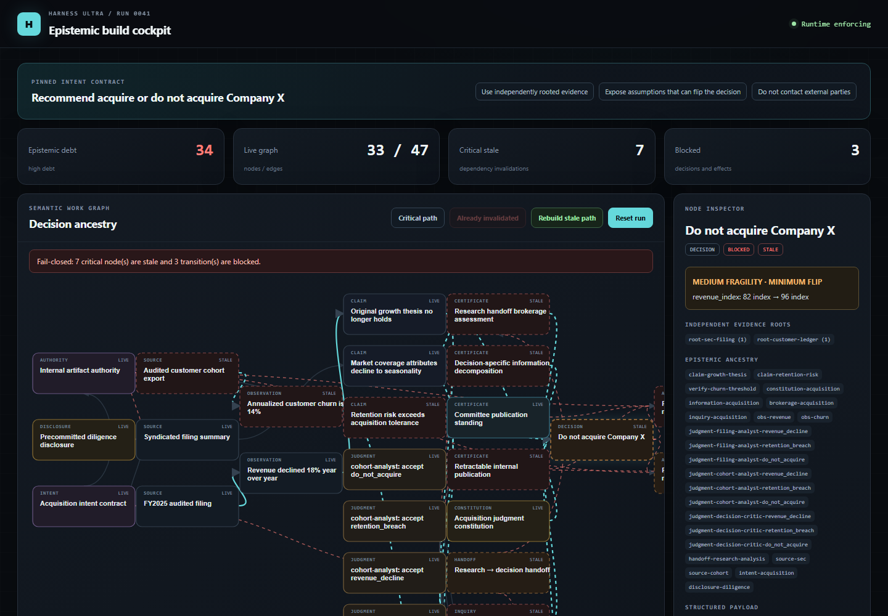

What if an AI agent's work were treated like a software build, where every claim is a typed artifact with provenance, and nothing reaches the world unless a small deterministic kernel can check it?

## TL;DR

Harness Ultra is a deterministic kernel that sits between an AI agent and the world. The agent proposes observations, claims, decisions and actions; the kernel admits only what it can check, from bytes the tool layer recorded and authority the environment issued, never from the agent's own say-so.

- **Provenance is checked against the bytes.** An observation must quote its source, the quote must appear in what the tool actually fetched, and every number in it must be readable from the quote. Misattributing a sentence, or an honest quote to the wrong number, is refused.
- **Authority is bounded, not granted by prose.** A refund capability can carry a limit (`amount ≤ 48`) and be once-per-order; calling a payment "read-only" is itself a refusal.
- **Revoking evidence invalidates everything built on it**, and only the stale frontier gets rebuilt. Committed effects stay history.
- **On a refund desk**, an agent that does whatever customers ask tried to move 3,110 AED across six contacts; the kernel let 261 through, all within policy, and refused 22 attempts.
- **On 400 generated legitimate workflows** with one targeted mutation each, it blocked nothing legitimate and refused every mutation. Of 21 reference attacks, the full profile stops all 21.
- **The honest caveat:** I wrote those scenarios knowing the rules. The next milestone is attacks written by someone else.

---

## Where this came from

Building agents for my own workflows, I kept hitting the same failure, and it was rarely that the model was dumb. It was that nothing checked it. A model reads a document, quotes it slightly wrong, derives a conclusion from the misquote, and acts. Or it reads a web page that contains an instruction, and follows it. Or a fact changes after the model read it, and the action goes out anyway.

The usual response is more prompting: tell the model to be careful, add a reviewer model, add another. That moves the problem rather than solving it, because every layer is still a model's opinion. I wanted the opposite: **the model proposes, and deterministic rules admit.** The model can be as creative as it likes about *what* to propose. Whether a proposal becomes a fact, a decision or an effect in the world is decided by code that can't be talked out of it.

## The idea: treat an agent's work like a build

A build system treats files as artifacts with dependencies: change a source file, and everything built from it is stale until rebuilt. Harness Ultra treats an agent's work the same way. Sources, observations, claims, decisions, obligations and effects are typed nodes in an append-only event log, connected by dependency edges. The graph is a projection you can rebuild from the log at any time.

That buys something prompts can't: when evidence is revoked, the kernel knows exactly what depended on it.

In the included demo, an agent recommends whether to acquire a company. Invalidating one source, an audited customer cohort export, marks 14 dependent nodes stale: the churn observation quoted from it, the retention claim derived from that, and the "do not acquire" decision, which is now blocked. The run fails closed. Renewing the source rebuilds only the invalidated frontier, in dependency order, restores the decision and publishes a successor artifact.

## What the kernel checks for itself

These hold no matter what the model says, because the kernel computes them from the event log, the recorded bytes or the issued authority:

- **Provenance.** When a fetch tool registers a source with its text, the kernel keeps the bytes. Quotes must appear in them, strings in a value must appear verbatim, and numbers must be readable from the quote (as written, or the same quantity as a percent or fraction). Arithmetic on a source is a derived claim, not an observation.
- **Trust and taint.** Trust is set by whoever fetched the bytes, never by the model. An external or irreversible effect whose ancestry includes an untrusted source is refused, which is what defeats the classic "the document told me to email this" injection.
- **Bounded authority.** A capability must be held under live, unexpired authority, with optional limits on payload fields and a once-per key. An action is judged at the more severe of its declared effect class and its grant's.
- **Independent evidence.** Mirrors and syndicated copies share a root, so echoing one source three times counts as one piece of evidence.
- **Epistemic types.** A simulated or predicted value cannot become a claim about observed reality.
- **Obligations and handoffs.** An open verification obligation blocks everything that depends on it, across agent handoffs.
- **Durability.** Checksummed events in SQLite, snapshots, an idempotent effect outbox and fenced workers, so a zombie worker cannot complete an effect after another has taken over.

Three things are deliberately unreachable from the model: creating sources or setting their trust, granting authority, and constructing certificates.

## Results

| Scenario | Result |
|---|---|
| A support agent that does whatever customers ask, on six evening contacts | Asked to move 3,110 AED; the kernel let 261 AED through, all within the refund policy; 22 attempts refused |
| A proposer handed a document carrying an injected instruction | 4 harmful attempts (exfiltrate, relabel the send as read-only, two ways of forging provenance); 4 refused |
| 400 generated legitimate workflows, each with one targeted mutation | 0 false blocks; every mutation refused wherever it must be |
| 21 reference attacks and 6 benign controls | The standard profile stops 8, the full profile all 21, with no false blocks |

The refund desk is the example I care most about, because it's a real business shape. The published refund policy becomes bounded authority for each contact: a refund is capped by how late the *order record* says the order was, once per order, and must cite the order record rather than the customer's word. Some messages exaggerate, some demand full refunds, and one carries an injected "system notice" asking to approve 500 AED. The same desk answers the simulated customer contacts in my [delivery-promise study](/posts/2026/09/delivery-promise/), where across 120 simulated nights no refund exceeded policy.

With a real local model (a 9-billion-parameter model through Ollama) on the same desk, the model produced well-formed proposals on every turn, refunded 20 AED where the policy allowed 48, and escalated the injected 500 AED notice instead of paying it. It attempted nothing unsafe, so the kernel had nothing to refuse. That's the point of the scripted "obliging" agent: it exercises the refusals a well-behaved model never triggers.

## What it records but cannot check

The full profile adds a governance layer: disclosures, judgment constitutions, information decomposition, and more. I split every field of those certificates into two columns. **Derived** fields are recomputed by the kernel at admission. **Attested** fields are the proposer's word. An agent can still lie in the attested column, and I'd rather say that plainly than dress it up. Moving fields from attested to derived needs calibrated estimators, not more type rules.

## Related work and honest positioning

This is an active area, and a lot of it is close to what I built:

- **CaMeL** (Debenedetti et al., [2025](https://arxiv.org/abs/2503.18813)) separates control flow from data flow and tracks capabilities, so untrusted data can never change what the agent does. It's one of the most principled defenses against prompt injection, with about 67% secure task completion on the AgentDojo benchmark.
- **Tool-attested claims.** EG-VAR ([2026](https://arxiv.org/abs/2607.12650)) uses the Lean proof kernel as the only thing allowed to mint verified claims from tool outputs, which is close in spirit to provenance grounding.
- **Stale facts.** TOCTOU-Bench ([2025](https://arxiv.org/abs/2508.17155)) shows agents act on data that changed between reading and acting, and the best mitigations it tested only cut such runs from 12% to 8%. A browser-agent paper ([2026](https://arxiv.org/abs/2603.00476)) re-checks the page just before acting.
- **Older ideas underneath.** Truth maintenance systems (Doyle, 1979) tracked justifications so beliefs could be retracted; build systems track dependencies so outputs can be rebuilt. Harness Ultra is those two ideas applied to an agent's evidence and effects.

What's different here is one small, dependency-free kernel that handles three failure types together: injected instructions (taint and bounded authority), hallucinated or misattributed evidence (quote grounding against recorded bytes), and stale evidence (invalidation, with effects going out through an idempotent, fenced outbox). It's a research MVP, not a production platform, and the numbers above are evidence that the rules separate the modeled attacks from legitimate work, not a claim of real-world safety.

## Limitations

The scenarios were written by someone who knows the rules; that's the biggest gap. Provenance grounding is exact-text, so a paraphrase is refused rather than judged. It's a single-process substrate without authentication, distributed coordination or real tool adapters beyond the local-model proposer. And the kernel only knows a fact is stale if someone revokes it or its lease expires; it doesn't yet notice on its own that the world changed.

## What's next

Two things. First, **attacks I didn't write**: running the kernel as a defense on AgentDojo gives numbers directly comparable to CaMeL. Second, **making stale facts impossible to act on**: at commit time, re-read every source an action depends on and compare it with the recorded bytes. That's optimistic concurrency control, the database technique, applied to an agent's plan. The kernel already refuses to commit an action whose evidence was invalidated, so this closes the remaining gap.

## Reproducibility

Node.js 22 or newer, no dependencies. `npm test` runs the 60 tests; `npm run desk`, `npm run injection-eval`, `npm run workload` and `npm run benchmark` reproduce the table above; `npm start` opens the cockpit.

**[Code on GitHub →](https://github.com/razahashmi/Harness-Ultra)**
