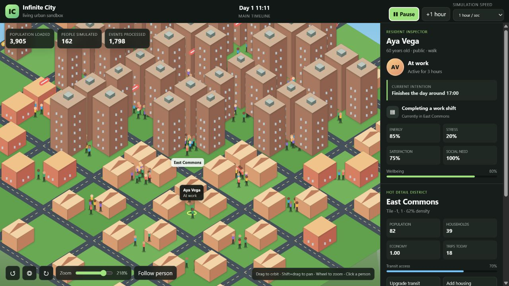

A city simulator you can walk into: it generates itself as you move, keeps every resident's identity when you look away, and can explain every decision anyone in it makes. Plus the two bugs that made its first version quietly lie.

## TL;DR

- **Two faces, one engine.** A streaming sandbox where you follow any resident through an endless city and see why they do what they do, and a batch engine that runs the same population through paired policy scenarios.
- **An endless city on a laptop.** Only the 3×3 tiles around the camera simulate individual people. The next ring runs household and district aggregates every six simulated hours, the outer ring once a day, and residents keep their identity and history as districts load and unload.
- **Decisions you can inspect.** Residents act on schedules, energy, stress, hunger, social needs, money and capacity, and each chooses how to travel by weighing what the trip would cost by every mode they have, at their own value of time.
- **Policy moves behavior.** On the default week, a transit upgrade moves car share from 23.5% to 17.8% and transit from 57.4% to 67.0%.
- **Two bugs worth confessing.** In the first version a transit upgrade couldn't move a single car owner, and changing the simulation's tick length changed its answers. Both are fixed and tested.
- **The honest positioning:** the rules are hypotheses, not calibrated predictions, and LLM-driven city simulators are now a crowded field. What this one offers is determinism, streaming scale and explainability.

---

## Where this came from

Last year I [built a sandbox of AI personas](/posts/2025/03/Sim-Personalities/) reacting to real tweets, which started from watching which of two identical paths people chose to walk to class. That sandbox captured what people say. I wanted the other half: what people *do* with a day. Where they go, how they get there, and what a change to the city does to all of it.

Two things shaped the design. First, [Terrain Diffusion](https://github.com/xandergos/terrain-diffusion) (Goslin, [2025](https://arxiv.org/abs/2512.08309)), which generates endless terrain hierarchically, coarse to fine, so any coordinate can be produced on demand. I borrowed the idea, not the model: coarse fields define districts, districts define households, households define people. Second, a rule I've come to rely on in every simulation I build: every run must be reproducible from its seed, and every number must come from something you can inspect.

## How the endless city works

The world is tiles at integer coordinates, generated lazily and deterministically from multi-scale continuous fields, so the same coordinate always produces the same district. Each district has homes, workplaces, schools, shops, cafes, parks and clinics, with opening hours, prices, capacity and live occupancy.

Simulating every person in an endless city is impossible, so the city has levels of detail, the way open-world games do:

- **Hot:** the 3×3 tiles around the focus run every resident individually through an event queue that jumps straight to the next meaningful moment.
- **Warm:** the next ring runs household and district aggregates every six simulated hours.
- **Cold:** the outer ring updates once a simulated day.

Move the focus and districts get promoted and demoted. A stable identity registry means that when you come back to a street, the person you followed is still who they were, with their history, friendships, wages and cash. You can snapshot the whole world, restore it, and branch alternate histories from any point.

Zoomed out, you see a quiet city summary. Zoom in and you get named residents, their current activity, the reason for it, their route and transport mode, their needs, budget and recent history. The point is that nothing happens without a reason you can read.

## How residents decide

Residents differ in age, occupation, income, what they own (car, bicycle), how flexible their schedule is, and how sociable they are. Weekday and weekend schedules create simultaneous travel demand, and activities change energy, stress, spending and satisfaction.

**Getting around.** Each trip picks among the modes a resident can use: a car if they own one, a bicycle if they own one and the trip is under 12 km, walking under 5 km, transit always. The choice is a multinomial logit on generalized cost: minutes in motion, waiting weighted 1.5 times, walking and cycling weighted 1.3 times, plus fares, running costs and parking converted to minutes at the resident's own value of time.

**Congestion that people remember.** Cars load roads and riders load transit lines; each meets the departures of the trailing hour against the route's hourly capacity. Residents use the congestion they saw on that route at that time on previous days, so a jammed morning line shifts tomorrow's choices.

## Result: policy changes behavior

The batch engine runs baseline, transit-upgrade and remote-work scenarios on the same generated population and random stream, so differences come from the policy alone. On the default 500-resident week:

| Scenario | Car share | Transit share | Walk + bike | Travel per resident |
|---|---:|---:|---:|---:|
| Baseline | 23.5% | 57.4% | 19.1% | 192.8 min |
| Transit upgrade | 17.8% | 67.0% | 15.2% | 157.8 min |
| Remote work | 22.0% | 58.0% | 20.0% | 181.9 min |

## The two bugs that made the first version lie

I want to be upfront about these, because both are the kind of bug that produces plausible numbers.

**Car owners always drove.** Mode was effectively a fixed rule, so a transit upgrade could only speed up people who were already on transit. The upgrade scenario produced mode shares identical to the baseline, and nothing in the output looked broken. The fix was the cost-based mode choice above, and a test now requires the upgrade to move car owners onto transit.

**The answers depended on the tick length.** Per-tick effects weren't scaled by how long a tick was, and trips occupied whole ticks. The same world gave a mean stress of 0.165 at 60-minute ticks and 0.261 at 15-minute ticks, and the travel clock said 660 minutes a week when the trips themselves summed to 158. Now effects are hourly rates applied to the minutes actually spent, trips end mid-tick, residents leave at their scheduled minute, and runs at 10-, 15-, 30- and 60-minute ticks produce identical trips and agree within about 1% on stress, satisfaction and travel time. That's also a test.

The lesson I keep relearning: a simulator should have tests for its *invariants* (results shouldn't depend on an arbitrary step size; a policy that changes costs should change choices), not just for its outputs.

## Related work and honest positioning

- **Validated transport models** such as MATSim, ActivitySim and SUMO are far more serious tools for real planning, calibrated against surveys and counts. Infinite City isn't trying to replace them.
- **LLM-driven city simulators** arrived in bulk in the last two years: [CitySim](https://arxiv.org/abs/2506.21805), [CityBehavEx](https://arxiv.org/abs/2607.12086) and [GenWorld](https://arxiv.org/abs/2606.27650), among others, following Generative Agents (Park et al., 2023). They buy rich behavior with model calls, which makes them costly per resident and hard to reproduce exactly.
- **Level-of-detail simulation** is standard practice in open-world games.

What Infinite City offers is the combination: deterministic and dependency-free, an endless world whose residents keep their identity, and cheap scale because detail follows your attention. It is a behavioral baseline, not a forecasting tool.

## Limitations

The transition and schedule rules are hypotheses. The results are consequences of those rules, not validated predictions, and the simulator would need calibrating against travel surveys, traffic counts, land use and time-use data before anyone used it to evaluate real policy. The batch engine runs on a demo city rather than a real network.

## What's next

Two directions. The practical one is a real network and calibration, starting with Dubai, whose time-of-day road tolls (since January 2025) are a natural experiment in what travel costs do to when and how people move. The more interesting one is **LLM residents only where you look**: generative agents in the district you're watching, cheap rules everywhere else, and every LLM decision checked against the world's rules (money, opening hours, capacity, travel time) before it happens. That's the same principle as my [agent kernel](/posts/2026/09/harness-ultra/): the model proposes, the world admits.

## Reproducibility

Python 3.10 or newer, no dependencies. `python -m urban_sim --sandbox --seed 42` opens the sandbox in a browser; `python -m urban_sim --compare` runs the paired policy scenarios; 20 tests cover population and capacity invariants, seeded reproducibility, tick-length independence, and the streaming world's identity, levels of detail and snapshots.
