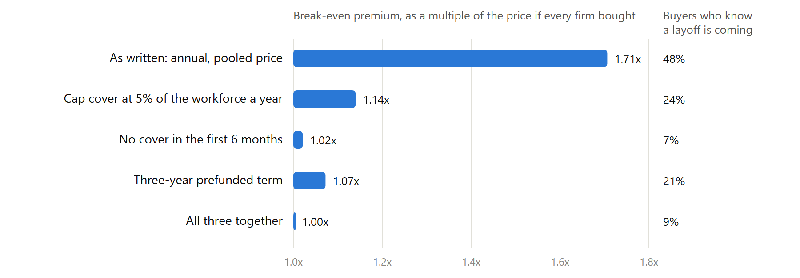

Private job-loss insurance fails because people know when their job is at risk. The obvious fix is to have the employer buy it for everyone. A small model shows the same problem reappearing one level up, and which contract terms make it go away.

## TL;DR

I've been exploring an employer-paid layoff benefit: the employer covers its whole workforce, and anyone laid off gets a real share of their salary for a few months plus help getting rehired. Before believing in it, I wanted to know whether the insurance underneath can exist at all.

- **For individuals, it can't.** Hendren (AER 2017) shows workers know their own job-loss risk better than an insurer can price it, so privately sold unemployment insurance is too adversely selected to make money at any price.
- **Employer-paid cover removes the worker's choice**, which is the same reason group life and disability insurance work where individual versions struggle.
- **But the employer still chooses**, and an employer knows its own layoff plans better than any underwriter. In my model, an annual contract at a pooled price only breaks even at **1.7 times** what the cover costs if every firm bought; one firm in ten buys, and **half the buyers already know a layoff round is coming**. At the price you'd set assuming no selection, the pool pays out 93 cents of every premium dollar against 61 planned.
- **The natural pitch makes it worse.** "Redirect the severance you already pay into a premium" is most compelling to firms about to cut: priced that way, the break-even rises to 2.2x and 72% of buyers expect a layoff round.
- **Contract terms fix it.** A waiting period on the employer's contract that outlasts how far ahead firms plan layoffs, a per-employer cap, and a multi-year prefunded term bring the break-even back to the no-selection price.
- **And the cover has to be worth buying when nobody is laid off.** Otherwise no price works at all.

---

## Where this came from

Layoffs have become a recurring feature of working life, especially in tech. Government unemployment insurance was designed as a floor, and for a six-figure salary it replaces a small fraction of income. Private products that let individuals insure their own income against job loss have come and gone.

The reason they go is textbook. The people most eager to buy job-loss insurance are the people who can see a layoff coming. So insurers price for them, which drives away everyone else, which raises the price again. Akerlof described the spiral in 1970; Rothschild and Stiglitz showed what it does to insurance contracts in 1976.

The standard way out is to take away the choice. If an employer buys cover for its entire workforce, nobody opts in because they're worried. Group life and group disability insurance work exactly this way. So an employer-paid layoff benefit, covering everyone, should sidestep the problem.

It sidesteps the worker's version of it. This post is about the employer's.

## The economics in one idea

Hendren's ([AER 2017](https://www.aeaweb.org/articles?id=10.1257/aer.20151655)) key quantity is the **pooled price ratio**: the markup the lowest-risk person would have to pay to be pooled with everyone riskier who'd also buy. If nobody values insurance enough to pay that markup, no price makes the market work. For workers' own job-loss risk, he estimates the markup is at least 70%, with point estimates above 300%, far more than people are willing to pay. That is why the individual market doesn't exist.

Now apply the same lens to employers. A firm that has decided to run a reduction in force next quarter knows something the underwriter doesn't. And the most natural sales pitch for a layoff benefit ("you already pay for layoffs reactively, as severance and outplacement; convert that into a smooth premium") is worth the most to exactly that firm.

## The model

One underwriting class: employers an underwriter cannot tell apart. In a year, 1.5% of a firm's workforce is let go individually, and a quarter of firms run a reduction in force (RIF) that lets go another 10%. That averages the 4% a year a plan like this might price on. A firm with a RIF coming in the next six months knows it when it signs with 80% probability, so one firm in ten signs knowing.

The benefit is plausible, not generous: 60% of pay for up to four months after a short wait, about $16,900 expected per laid-off employee on a $130,000 salary. The premium is 1.45 times expected payouts plus a service cost, which comes to about $1,100 per employee a year if every firm bought.

A firm buys when cover is worth more to it than the premium. Cover is worth two things: the payouts, counted at 80 cents on the dollar as severance it would otherwise pay, and a value that has nothing to do with its own layoffs (retention, morale, being a better employer), $300 per employee a year for the median firm, spread widely across firms. The premium must cover the firms that actually buy.

## What it finds

**As written, the pool doesn't collapse, but it shrinks and turns.** An annual contract at one pooled price only breaks even at $1,875 per employee a year: 1.7 times the no-selection price. At that price one firm in ten buys, half of them knowing a RIF is coming (against one in ten of all firms), and their covered layoff rate is 7.1% instead of 4%. At $1,100, 29% of firms buy and the loss ratio is 93% against 61% planned.

**How you sell it changes who buys:**

| How it's sold | Break-even vs. every firm buying | Buyers expecting a RIF |
|---|---:|---:|
| As a full replacement for severance and outplacement | 2.2x | 72% |
| As severance-adjacent (payouts valued at 80 cents on the dollar) | 1.7x | 48% |
| On retention, with the firm keeping its severance policy | 1.2x | 19% |

**Underwriting only stable employers doesn't fix it.** If only 15% of firms in a class run a RIF, cover gets cheaper, but the break-even premium is still twice the no-selection price, because the firms that know something still buy first.

**The fix is in the contract:**

| Contract | Price if every firm bought | Break-even | Firms buying |
|---|---:|---:|---:|
| Annual, pooled price | $1,099 | $1,875 (1.71x) | 10% |
| Cover capped at 5% of the workforce a year | $701 | $800 (1.14x) | 34% |
| Three-year prefunded term | $1,100 | $1,180 (1.07x) | 24% |
| No cover in the first 6 months of a contract | $607 | $620 (1.02x) | 44% |
| All three together | $613 | $615 (1.00x) | 45% |

The waiting period on the *employer's contract* is the strongest single lever, and it has to outlast how far ahead firms can see a RIF coming. If firms plan nine or twelve months ahead, a six-month wait fails (1.9x and 2.8x). A twelve-month wait on a three-year term holds at every horizon I tried, and so does the combination. Note that a short waiting period on each *employee's* claim does nothing here: the selection happens when the employer signs.

**The cover has to be worth buying when nobody is laid off.** With nothing but the payouts, no price works even if firms know nothing, because cover costs $1.45 per dollar paid out and a firm values that dollar at 80 cents. The value a benefit like this creates while people keep their jobs has to carry at least the insurance load. Notably, even a modest amount of foreknowledge, a firm-level pooled price ratio of 1.27 (well under Hendren's lower bound of 1.7 for workers), is enough to thin the pool, because the load leaves no room.

## What I'd take from this

For anyone designing layoff cover, or any group insurance where the buyer controls the risk:

1. **Put the waiting period in the contract, not just the claim**, and make it longer than the buyer's planning horizon.
2. **Ask at signing.** A representation that no reduction in force is planned, with early claims reviewed against it, is the legal version of the same wait.
3. **Prefund multi-year terms**, so nobody can buy in a bad year and leave in a good one.
4. **Sell the benefit people get while employed**, not the payout: selling it as a severance replacement recruits exactly the buyers who will claim.
5. **Measure planning horizons early.** How far ahead do employers know about their layoffs? That single number sets the waiting period.

Group disability insurance has long used the same tools, such as actively-at-work requirements and pre-existing-condition exclusions, to keep people from buying cover for a claim they already see coming. The employer-level version needs the same thing.

## Related work

Akerlof (1970) on the lemons spiral; Rothschild and Stiglitz (1976) on insurance under private information; Einav and Finkelstein (2011) for the demand-and-average-cost picture this model computes; and Hendren (2017) for the empirical case that individual unemployment insurance can't exist privately. The model here is a direct application of that framework to the employer as the buyer.

## Limitations

One underwriting class and illustrative numbers. The parts that decide the answer (how much firms know, how far ahead, how they value the benefit, and how it's sold) are varied rather than assumed, but none is measured. Not modeled: firms laying off more once insured, correlated layoff waves across firms (a separate and serious question for the insurer's capital), and experience rating at renewal, which helps over time but can't see a RIF coming. "Firms buying" is the share of a class that would say yes at that price, not a forecast.

## Reproducibility

The model is a few hundred lines of Python, runs in about a second, and reproduces the no-selection price exactly when firms know nothing, which is the first thing I checked.
