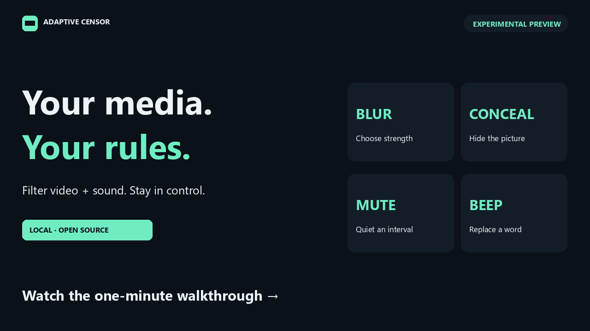

Different people want different things from the same film. Adaptive Censor is a local video and podcast player that analyzes ahead of the playhead, applies the picture and sound rules you choose, and lets you correct its mistakes on a timeline. The first preview is out. This is what it does well, and what it doesn't do yet.

## TL;DR

- **Your rules, one category at a time.** Allow kissing, blur violence lightly, conceal a reviewed scene and mute its sound, beep only the words on your list. Anatomy, sexual activity, violence, gore, kissing, language and custom visual concepts each get their own picture and sound rule.
- **Predictions and preferences are kept apart.** The models build a timeline of events, and your settings decide what happens during each one. Changing a setting doesn't run any model again.
- **Correcting it is part of the product.** Compare the original and filtered picture, exclude a false match, add a missed interval, or report a mistake with one click while watching.
- **The software is tested; the detectors aren't good enough yet.** 223 runtime tests and 53 browser tests pass. Recognition is another matter, and below are the numbers. This is a preview for people willing to review the timeline, not an unattended filter.
- **It runs on your machine.** No application telemetry, no cloud inference, no automatic upload. MIT license.

## How it works

Every decision starts as an event: a category, a start and an end, the evidence for it, and sometimes a region of the frame. Your policy decides the effect. The picture can be allowed, blurred at a strength you pick, or concealed completely; the sound can be kept, muted, or beeped. Two people can watch the same reviewed timeline with different settings.

Analysis runs ahead of playback, by default 30 seconds ahead, in six-second chunks. A file starts playing once about six seconds are ready, and if analysis falls behind, the player pauses before content it hasn't checked rather than play it. A buffer absorbs slow moments; it can't rescue a machine that is slower than playback overall.

The models are local: speech recognition for words and their timing, an anatomy detector for regions, image-text similarity for suggestions, and an optional local vision-language model to check scenes. Scene suggestions don't filter anything until you confirm them.

## What the evidence says

There are two questions here, and they have different answers.

**Does the software do what the rules say?** Mostly, yes. The release passed 223 runtime tests (seven skipped for optional training dependencies), all 53 browser-module tests, and checks of installation, feedback, export and restart, with CI on GitHub. In a short CPU diagnostic, one Ryzen 9 9950X3D processed 26 seconds of media in 11.84 seconds, startup included. That is one machine and five short clips, not a hardware requirement.

**Do the detectors find the right content?** Not reliably. In the latest comparison on 42 human-reviewed clips, an experimental crop check cut wrongly filtered nudity time by 44.8% without losing any of what was caught. Even with it, only 35.3% of the filtered time was correct, and the filter caught 31.9% of what it should have, from just three labeled events across two titles. That crop check isn't enabled in this release. No new detector has qualified for automatic filtering, the scene classifier's automatic thresholds stay off, and there is no 95% accuracy claim. The [limitations page](https://github.com/razahashmi/Adaptive-Censor/blob/main/LIMITATIONS.md) has the details.

I would rather publish that gap than a demo that hides it. The controls are useful even when a detector is wrong, because the timeline can be checked and fixed. The detectors are the part that needs work.

## A mistake becomes a review task, not training data

**Wrongly censored** and **Missed something** save a report at the current playback time, with an optional short clip kept on your machine for context. Nothing is uploaded. A report is not a label: the intended path is to inspect it, mark exact intervals, keep training and evaluation titles apart, tune a candidate offline, and qualify a specific model before it is enabled. The player never quietly retrains itself from your clicks.

## Try it, or help

The [Windows preview](https://github.com/razahashmi/Adaptive-Censor/releases/tag/v0.3.0-preview.1) needs 64-bit Python 3.13. Its setup helper is unsigned, and a clean-Windows installation hasn't been independently verified yet. The most useful help right now:

- an installation report from a clean Windows machine;
- reviewed public examples across more titles;
- speech evaluation on everyday audio.

The code is on [GitHub](https://github.com/razahashmi/Adaptive-Censor) under the MIT license, and the [starter tasks](https://github.com/razahashmi/Adaptive-Censor/blob/main/docs/STARTER_TASKS.md) are scoped for a first contribution.

*The demo video uses footage by Anna Tarazevich / Pexels and from* Tears of Steel *(CC BY 3.0, Blender Foundation). [Full credits and terms](https://github.com/razahashmi/Adaptive-Censor/blob/main/docs/MEDIA_CREDITS.md).*
